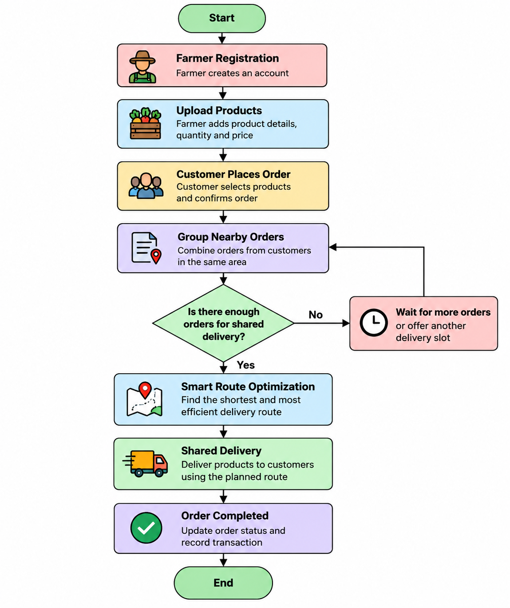

# Smart India Hackathon Workshop
# Date: 24/10/2026
## Reference Number: 26014662
## Name: Kiran P

## Problem Title
SIH 26033: Multiple intermediaries reduce farmers earnings and increase consumer prices.

## Problem Creater's Organization
Ministry of Consumer Affairs, Food & Public Distribution

## Theme
Agriculture, FoodTech & Rural Development

## Problem Description
Expected Solution: Create a digital marketplace that:

• Connects farmers/FPOs directly with consumers and bulk buyers.
• Provides logistics support.
• Uses AI for demand forecasting and route optimization.

Benefits:

• Better prices for farmers.
• Lower prices for consumers.
• Reduced supply chain inefficiencies.

## Proposed Solution
### Proposed Solution

Farmers can upload their products with prices, and consumers can order fresh products directly from them. To reduce transportation costs, our platform will combine orders from nearby customers and find the shortest possible delivery route. This helps farmers earn better profits and consumers buy products at lower prices. The unique feature of our solution is it reduces transportation expenses, saves time, and makes direct buying easier for both farmers and consumers.

## Technical Approach
### Technical Approach

It is to develop a simple website using HTML, CSS, and JavaScript for the frontend, Python with Django for the backend, and SQLite for storing farmer details, product information, and customer orders. Farmers can upload their products with prices, and customers can select and order them. 

## Feasibility and Viability
### Feasibility and Viability

It is practical because we can develop the website using basic programming languages and free tools. We can first test it in a small local area with a few farmers, customers, and products before expanding it. We plan to create a simple and user-friendly website, provide basic guidance to farmers, and use shared delivery with route planning to reduce transportation costs. 

## Impact and Benefits
### Impact and Benefits

It helps farmers earn better profits by selling their products directly to consumers without unnecessary middlemen. Consumers can get fresh products at affordable prices. It also supports farmers in rural areas by giving them more opportunities to sell their products. It can reduce transportation costs, save fuel, and minimize pollution. 

## Research and References
### Research and References

1. e-NAM: Agricultural online marketplace.
2. AGMARKNET: Information about crop prices.  
3. Google Maps: To understand delivery routes.  
   
